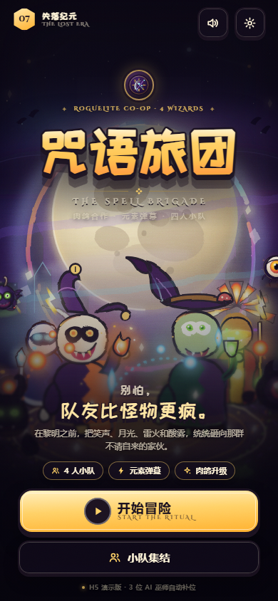
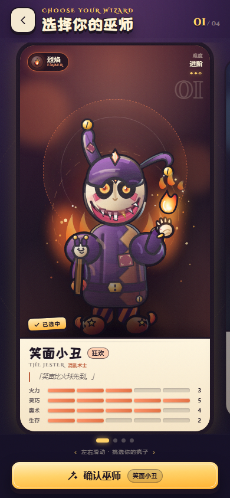
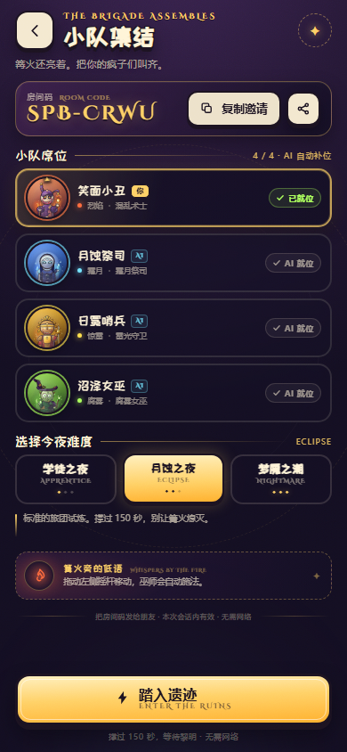
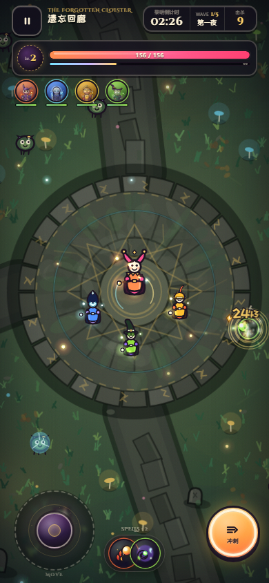
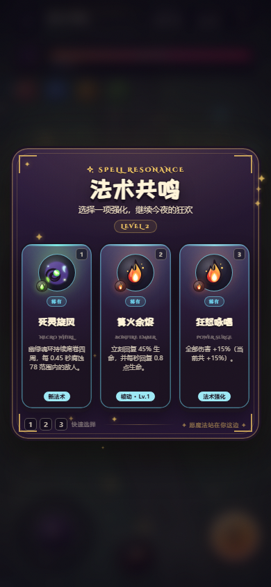
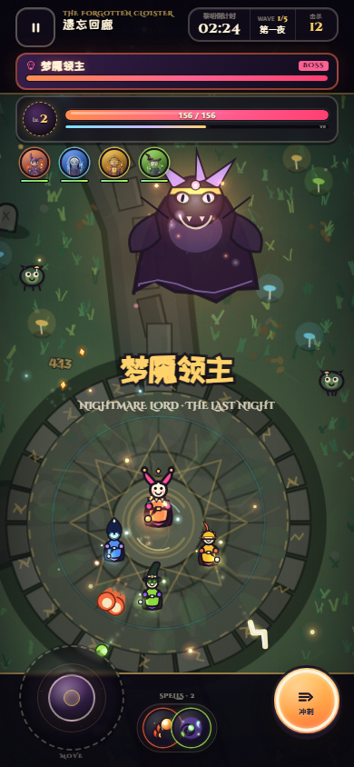
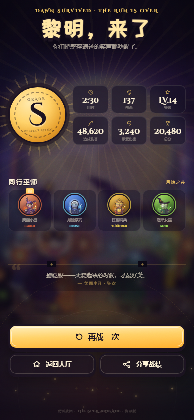
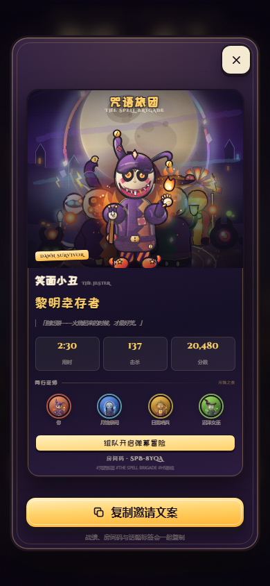

# 咒语旅团 · THE SPELL BRIGADE

> **在线试玩：** <https://huangyb7.github.io/CursedBrigade/>
>
> 一个可直接在浏览器里玩的竖屏 H5 肉鸽弹幕生存 Demo。
> 暗黑童话 × 怪诞 Q 萌 × 四元素法术 × 四人小队（1 名玩家 + 3 位 AI 巫师）。
>
> **双击 `index.html` 即可开始**，无需安装、无需联网、无需构建。

---

## 🎮 立即开玩

- **在线试玩**：<https://huangyb7.github.io/CursedBrigade/>
- **在线源码**：<https://github.com/huangyb7/CursedBrigade>
- 打开项目根目录的 `index.html` 即可开始。
- 也可下载仓库根目录的 `咒语旅团_H5_Demo.zip`，解压后双击其中的 `index.html`。

- 桌面端：双击后自动进入居中手机框，推荐用 Chrome / Edge。
- 移动端：把整个文件夹传到手机，用浏览器打开 `index.html`；也可在电脑上起一个本地服务后同 Wi-Fi 访问：
  ```bash
  cd CursedBrigade
  python -m http.server 8123
  # 浏览器打开 http://127.0.0.1:8123/
  ```
- 推荐音量开启：所有音乐与音效都是 WebAudio 实时合成的，无音频素材。
- 本作是 **单机 Demo**：`小队集结` 中的 4 人席位、邀请码和分享海报是演示闭环，战斗中的另外 3 名巫师由 AI 自动补位，**没有真实联网后端**。

---

## ✨ 核心特色

- **4 名怪诞巫师**：笑面小丑（火）、月蚀祭司（冰）、日冕哨兵（雷）、沼泽女巫（酸），每位都有独立立绘、主题色、属性与起始法术。
- **俯视角魔法弹幕**：自动瞄准、自动施法，操控走位与冲刺；火冰电酸四种元素拥有不同的弹道、拖尾、命中与元素效果。
- **4 人小队**：3 位 AI 巫师会跟随玩家、自动攻击、倒地后自动归队，形成真正的“旅团”感。
- **肉鸽三选一**：23 项升级 / 新法术 / 被动，升级即暂停，从法术共鸣中构筑本局流派。
- **Boss 与波次**：从第一夜到第五夜，撑过 150 秒；120 秒梦魇领主登场，有冲撞、扇形弹幕、召唤与暴怒阶段。
- **H5 完整流程**：开屏 → 选择巫师 → 小队集结 → 战斗 → 升级/暂停 → 胜利或失败结算 → 9:16 分享海报。
- **手绘感视觉**：19 张自绘 SVG 资产 + Canvas 程序化战场；粗墨线、油画颗粒、高饱和魔法色、漂浮符文和体积光。
- **离线可用**：不依赖 CDN、不请求外部字体；字体、图片、脚本、音频全部在本地。
- **响应式**：375×667 / 390×844 / 430×932 / 桌面 1280×900 自适应，支持安全区和触摸。

---

## 🕹 操作

| 操作 | 手机 | 桌面 |
|---|---|---|
| 移动 | 拖动左下摇杆 | `WASD` / 方向键 |
| 冲刺（短位移 + 无敌帧） | 点右下「冲刺」 | `Space` |
| 施法 | 自动 | 自动 |
| 升级选择 | 点击卡牌 / 数字 1、2、3 | 点击卡牌 / 1、2、3 |
| 暂停 / 继续 | 左上暂停按钮 / `Esc` | `Esc` |

> 目标：在「遗忘回廊」撑过 **150 秒**，等待黎明。Boss 未死也可撤离胜利，击杀 Boss 有额外奖励分。
> 难度分为「学徒之夜 / 月蚀之夜 / 梦魇之潮」，可在小队集结页选择。

---

## 🖼 预览

| 首页 | 角色选择 |
|---|---|
|  |  |

| 小队集结 | 战斗 |
|---|---|
|  |  |

| 法术共鸣（升级三选一） | Boss |
|---|---|
|  |  |

| 结算 | 分享海报 |
|---|---|
|  |  |

更多尺寸：[`screenshots/`](screenshots/)。

---

## 👹 巫师图鉴

| 巫师 | 元素 | 定位 | 玩法关键词 |
|---|---|---|---|
| 笑面小丑 · 狂欢 | 烈焰 | 混乱术士 | 高机动、弹射火花、爆发 |
| 月蚀祭司 · 塞勒涅 | 霜月 | 霜月祭司 | 减速冻结、安全后排 |
| 日冕哨兵 · 赫利俄斯 | 惊雷 | 雷光守卫 | 连锁闪电、正面压制 |
| 沼泽女巫 · 苔藓 | 腐雾 | 腐雾女巫 | 持续腐蚀、范围侵蚀 |

---

## 📁 项目结构

```text
CursedBrigade\
├─ index.html              ← 入口，双击即玩
├─ README.md
├─ CONTRACT.md             ← 团队开发契约（接口 / 资产 / QA 标准）
├─ .gitignore
├─ screenshots\            ← 最终预览图
├─ assets\                 ← 19 张自绘 SVG + 离线字体
│  ├─ hero-scene.svg       ← 首页主视觉
│  ├─ wizard-*.svg         ← 4 张角色立绘
│  ├─ element-*.svg        ← 元素图标
│  ├─ spell-*.svg          ← 法术图标
│  └─ fonts\               ← 站酷快乐体 / Cinzel Decorative
├─ css\
│  ├─ fonts.css            ← 字体 + 设计令牌
│  └─ style.css            ← 全部页面 / 动效 / 响应式样式
├─ js\
│  ├─ data.js              ← 角色、元素、难度、文案数据
│  ├─ audio.js             ← 程序化 WebAudio 音乐与音效
│  ├─ game.js              ← Canvas 2D 战斗引擎
│  └─ ui.js                ← 路由、HUD、弹窗、分享与音频接线
└─ _review\                ← 本地 QA 产物（未提交到仓库）
```

---

## ✅ 已验收

- **完整链路**：loading → home → roster → lobby → game → levelup → pause → result → share → 返回大厅，全部通过。
- **真实引擎联调**：Canvas 铺满、HUD 与回调同步、摇杆拖动、冲刺冷却、升级恢复、Boss 血条、胜负回调、重开与销毁清理。
- **离线与 file://**：双击打开正常；字体、SVG、脚本、WebAudio 无 404。
- **无头 Chrome QA**：33 张多尺寸截图；`overflowX = 0`、HUD 无重叠、无破图、无 console / page JS 错误。
- **平衡模拟**：150 秒自动对局 3/3 胜利（Lv.20、Boss 击杀、评级 A），仍保留翻车空间。
- **四种角色**均能独立开局，起始元素法术与队伍配置正确。

已知限制：

- 演示版没有真实联机/房间服务器，邀请码和分享文案用于演示和传播；3 名队友为 AI。
- iOS Safari 未进行真机回归；建议使用 Chrome / Edge / Android Chrome。
- 分享海报按当前版本为 DOM 卡片，不提供“保存为图片”；可复制邀请文案。
- 375×667 属于紧凑布局；低于 640px 高度的设备未专门适配。

---

## 🧪 调试参数（开发者 / 截图用）

| 参数 | 作用 |
|---|---|
| `?autostart=1` | 跳过开屏加载，直接到首页 |
| `?nofx=1` | 关闭 CSS 动效，保留操作提示（截图用） |
| `?screen=home\|roster\|lobby\|game\|result\|share` | 直达指定屏幕 |
| `?screen=game&modal=levelup` | 开局后直接打开升级三选一 |
| `?modal=pause\|settings\|share\|boss\|result\|defeat\|copy` | 打开对应调试浮层 |
| `?result=defeat` | 使用失败结算样式 |
| `?audit=1` | 将布局审计 JSON 写入页面 title |

引擎实例暴露在 `window.SBGame`，提供 `debugLevelUp()` / `debugSpawnBoss()` / `debugWin()` / `debugLose()` / `debugSetTime(sec)` / `debugAddXp(n)` / `getHud()` 等 QA 方法。

---

## 🌙 制作说明

- 技术栈：纯原生 HTML / CSS / JavaScript，无框架、无构建、无依赖；Canvas 2D 战斗 + SVG 美术 + WebAudio 合成音频。
- 美术：19 张自包含 SVG（角色、元素、法术、主视觉、徽记、怪物），统一粗轮廓、暖主光 / 冷轮廓光、油画颗粒与高饱和魔法色。
- 字体：站酷快乐体（ZCOOL KuaiLe）、Cinzel Decorative，全部以本地文件随包分发。
- 灵感来源：[The Spell Brigade](https://store.steampowered.com/app/2589220/The_Spell_Brigade/)；本项目为非官方、非商业的学习 / 演示作品。

> 在黎明之前，把笑声、月光、雷火和酸雾，统统砸向那群不请自来的家伙。
